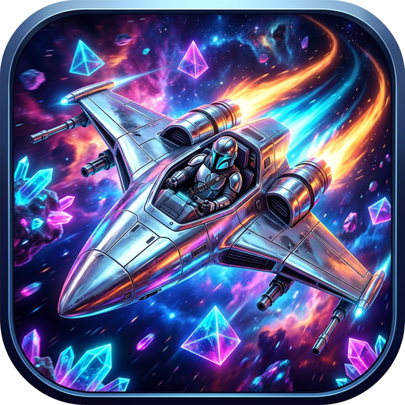

# 🚀 Bruno Run - 3D Space Exploration Game

  

  <b>Jogo de exploração e corrida espacial 3D em alta velocidade!</b> 
  Jogue online no navegador ou baixe o APK para Android!

---

## 🌐 Jogar Online no Navegador (PC & Celular)

👉 **[CLIQUE AQUI PARA JOGAR AGORA (GitHub Pages)](https://iapetec.github.io/bruno-run/)**

- **Controles no PC**:
  - `W, A, S, D` ou `Setas do Teclado`: Pilote a nave em 3D (subir, descer, esquerda, direita).
  - `Barra de Espaço`: Libera o **Turbo de Plasma** em alta velocidade!
- **Controles no Celular / Touch**:
  - Toque e arraste em qualquer lugar da tela para manobrar.
  - Toque no botão **⚡ TURBO PLASMA** no canto inferior direito.

---

## 📲 Download do APK para Android

👉 **[Clique aqui para baixar o APK direto (v1.4.0)](https://github.com/iapeTEC/bruno-run/releases/download/v1.4.0/Bruno-Run.apk)**

  
   
  <i>Aponte a câmera do celular para baixar o APK direto!</i>

---

## 🔑 Sistema de Usuário com PIN de 4 Dígitos & Recorde Protegido

- **Seu Nome + PIN de 4 Dígitos**: Ao iniciar, digite seu nome de piloto e um PIN secreto de 4 dígitos.
- **Proteção Anti-Duplicação**: Cada piloto possui **apenas 1 registro no ranking global**.
- **Atualização Segura de Recorde**: Sua pontuação só é atualizada se você bater seu próprio recorde anterior e o PIN bater com o PIN original do seu piloto. Ninguém pode sobrescrever seu recorde!

---

## 📊 Banco de Dados & Ranking Oficial no Google Sheets

O jogo é integrado via **Google Apps Script** para salvar automaticamente os dados de cada partida:
- 📊 **[Acesse a Planilha do Google Sheets com o Ranking](https://docs.google.com/spreadsheets/d/1oRm3LtkGdlRF1EkGcl2h-UGfrV0MVi4LbM5mWkWl97M/edit)**

---

## 🪐 Fases do Jogo (Incluindo a FASE CHEFÃO)

1. **🏎️ Fase 1: Podracer Vermelho do Anakin Skywalker (0 a 999 pontos)**
   - Voo rasante sobre a superfície desértica do planeta com solo firme e sombra dinâmica.
   - Três sóis (um sol gigante e dois companheiros) nascendo no horizonte em fade matinal suave.
   - Obstáculos: Pirâmides e obeliscos de cristal estáticos.

2. **🛡️ Fase 2: Razor Crest do Mandaloriano (1.000 a 2.499 pontos)**
   - Ao desbloquear a Razor Crest, a **velocidade reinicia** de volta ao cruzeiro para você se adaptar.
   - O planeta entra em pôr do sol carmesim com os 3 sóis se pondo no horizonte.

3. **🚀 Fase 3: N-1 Starfighter Modificada com Grogu (2.500 a 4.499 pontos)**
   - Velocidade reinicia de volta ao cruzeiro inicial com a nova nave veloz.
   - O planeta entra na noite estrelada.

4. **☄️ Fase 4: FASE CHEFÃO - ESPAÇO PROFUNDO & METEORITOS (4.500+ pontos)**
   - **Decolagem atmosférica**: O solo e os cânions desaparecem, entrando no vácuo do **Espaço Profundo** com estrelas cósmicas à distância!
   - Os obstáculos tornam-se **METEORITOS e ASTEROIDES 3D gigantescos e rochosos** flutuando no vácuo espacial.
   - A velocidade é reiniciada no início da Fase Chefão para fôlego inicial, acelerando gradativamente no desafio supremo de sobrevivência!
   - Há um botão na tela inicial para testar a **Fase Chefão** diretamente a qualquer momento!

---

## 🎮 Como Jogar

- **Pilote em 3D**: Toque e deslize o dedo na tela para movimentar a nave para todos os lados (cima, baixo, esquerda e direita). No teclado, use as setas ou W, A, S, D.
- **Desvie dos Cristais**: Existem cristais flutuantes pequenos, aglomerados pontiagudos e gigantescas **pirâmides de cristal** luminosas onde você precisa manobrar pelo vão entre elas.
- **Setores Livres (Espaços Vazios)**: Periodicamente, você entrará em zonas vazias do espaço sinalizadas no painel ("SETOR LIVRE"). É a oportunidade perfeita para ativar o turbo em segurança!
- **Jato de Plasma (Turbo Boost)**: Toque no botão **⚡ TURBO PLASMA** no canto inferior direito para ativar o propulsor de plasma. O campo de visão se alarga em efeito hiperespacial, a velocidade dobra e sua pontuação multiplica por 3x durante o turbo!
- **Dificuldade Crescente**: A velocidade do voo aumenta gradualmente conforme a pontuação sobe.
- **Colisão e Reinício**: Bater em qualquer obstáculo encerra a partida, salva seu recorde e permite reiniciar instantaneamente com um toque.

---

## 🛠️ Tecnologias Utilizadas

- **Renderização 3D**: Three.js WebGL com iluminação dinâmica, partículas e shaders otimizados para dispositivos móveis.
- **Áudio**: Web Audio API gerando sons de turbina, laser de plasma, impacto e fanfarras de desbloqueio em tempo real.
- **Android Runtime**: Android SDK 34, Hardware Acceleration ativada, Immersive Fullscreen Mode.
- **Automação CI/CD**: GitHub Actions com Gradle 8.5 gerando o APK e publicando a Release automaticamente.
